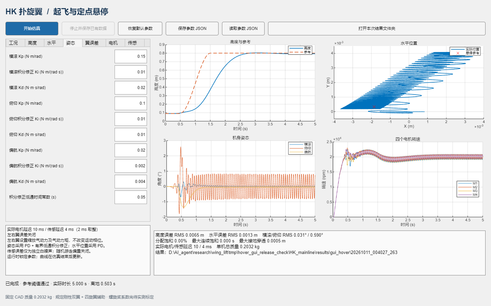
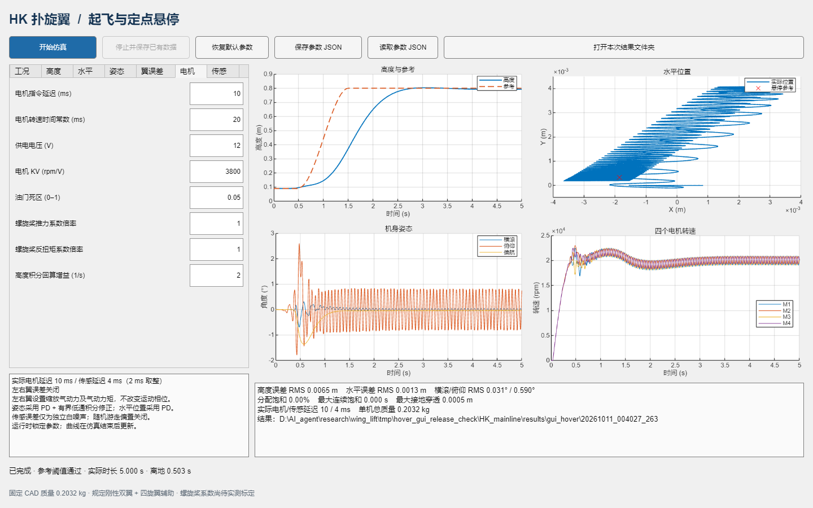

# GUI 操作与分析

在 MATLAB 打开包根目录，运行 `app = hk_hover_gui;`。也可运行 `app = run_mainline;`。

## 调参顺序

1. 工况页设置频率、悬停高度、时长、扑翼与高度参考渐入时间。默认 15 s 可覆盖完整悬停阶段。
2. 高度页设置外环位置 P 与垂直速度内环 PID，调整积分、速度参考、加速度限制。
3. 水平页分别设置 X/Y 的 PD，调整加速度与倾角参考上限。
4. 姿态页设置横滚、俯仰、偏航的 P/D 和低频积分修正。积分力矩仍受现有控制器限制（横滚/俯仰/偏航 0.03/0.02/0.03 N·m）。
5. 左右翼页勾选启用误差后设置各自百分比。`+3/-3` 对应 `1.03/0.97`；关闭时百分比不生效。
6. 电机页设置四个辅助电机共用的动态/电气参数。延迟 0 表示无指令队列延迟；时间常数 0 表示瞬时转速平衡，仍保留分配及推力上限。桨系数改变后会重新派生推力、反扭矩和混控矩阵。
7. 传感页设置延迟（最小 2 ms，避免状态到规定运动链的代数环）；勾选白噪声后，位置、速度、姿态、角速度分别采用所设标准差，三个轴使用同一标量。随机游走偏置固定关闭，种子在工况页设置。
8. 点击开始仿真。仿真时间与计算耗时不同。参数在运行期间锁定，曲线在结束后更新；停止按钮保存部分结果。

保存/读取 JSON 使用系统文件选择窗口。导入配置在整体校验通过后才更新界面，拒绝未知/缺失字段、NaN、负增益、非整数种子或越界数值。设置范围用于输入检查，不保证每组增益都能稳定飞行。

## 曲线和指标

高度图包含实际高度与渐入参考；水平图为 XY 平面中的位置和悬停参考点；姿态图为横滚/俯仰/偏航角；转速图包含 M1–M4 的实际转速。

RMS 指标沿用整机日志采集器：从离地 2 s 后到结束，至少 1 s 统计窗口。高度和水平 RMS 比较实际位置与控制参考；横滚/俯仰 RMS 比较零角度。短仿真或过早停止时显示“统计窗口不足”，不会把未计算的指标当作零误差。CSV 还包含角度参考、参考误差、翼升力、四电机推力/油门/延迟油门、电流、控制力矩和接地穿透量，可进一步选择稳态窗口。

指标中的 `pass` 是原采集器的宽松数值筛选：状态有限、XY/高度 RMS < 0.2 m、横滚/俯仰 RMS < 8°、接地穿透 < 5 mm、连续饱和 < 0.5 s；不等价于实机性能验收。完整结束仅表示日志运行到了请求时刻；有效窗口超出筛选阈值时，界面明确显示“参考阈值未通过”。

## 自动保存

每次运行使用独立时间戳文件夹；MAT/CSV/JSON 在曲线绘制前落盘，随后保存 PNG。

| 文件 | 内容 |
|---|---|
| `parameters.json` | 可直接重新导入 GUI 的输入参数 |
| `applied_config.json` | 完整生效配置、实际时长与请求时长 |
| `result.mat` | 结果结构体、诊断表、采样数组、指标、参数、源文件 SHA-256、MATLAB 版本 |
| `diagnostics.csv` | 完整状态和推进/控制日志 |
| `metrics.json` | 完成/手动停止/提前结束状态、统计指标、实际延迟等 |
| `chart_1.png`–`chart_4.png` | 四个图窗的曲线 |

手动停止后的分析只覆盖真实已运行的时间，不将短日志外推到原定结束时刻。没有状态日志的失败会显示错误；异常提前结束且有日志时保存部分数据并提示检查 MATLAB 诊断信息。之前的结果不会显示为这次新运行的结果。

## 模型与工作区

GUI 专用模型为 `models/flappy_hk_gui_hover.slx`，以已有的 15 Hz 悬停模型为母模型，机械与气动拓扑保持一致。后端在内存中配置延迟块与输出日志，结束时关闭专用模型，不把运行参数写回 SLX。为保护未保存更改，已打开的专用模型会阻止新会话；运行其他 Flappy 模型时也会阻止并发启动。

日志使用本会话独有的变量名，采集后清除；既有全局仿真配置在会话结束后恢复。界面与命令行共用 `HKHoverSession` 后端。

## 模型重建

通常直接使用随包携带的模型即可。`build_mainline("derived")` 从四旋翼母模型重新生成悬停与 GUI 模型；`build_mainline("full")` 从当前 CAD/URDF 重新导入机械祖先再生成悬停。完整重导入需要本机 `smimport` 对应工具箱。重建前先关闭所有 Flappy 模型。历史圆形/8 字、脉冲和滤波工况不在新的构建流程中。

## 界面预览

